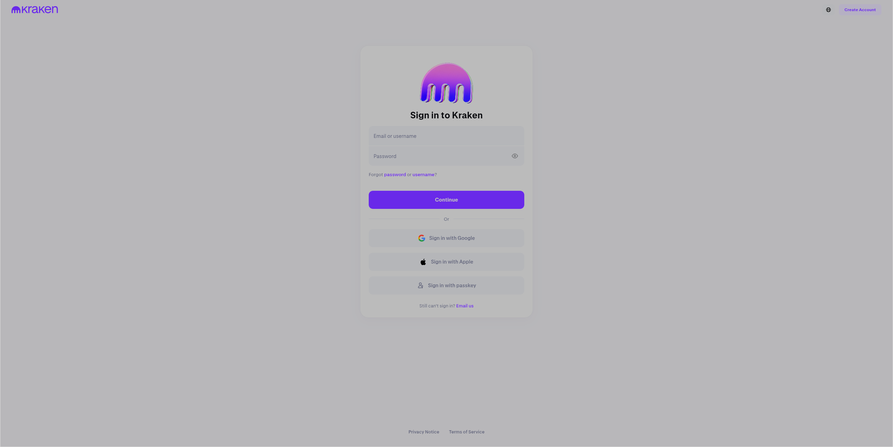

# Crypto Exchange Sign in & Register Flow Replica

<p>
  A school project replicating the authentication and onboarding forms of a Crypto Exchange using <strong>HTML5</strong>, <strong>CSS</strong>, and <strong>Vanilla JavaScript</strong>.
  <br>
  Created for the purposes of revising the basics of front-end web development, form validation, and responsive design. No data is collected or stored.
</p>

---
## ⚠️ Disclaimer

This project is created strictly for educational purposes as part of a school assignment.

## Live Demo

You can **[check out the website](https://andrejzega.github.io/CryptoExchange_Login/)** right here on GitHub through GitHub Pages.

### Credientials

The demo credientials a are:
- **Email / username**: user@example.com
- **Password**: Password123!

---

## Features

- **Landing Page (`index.html`)**: Simple disclaimer page with a button to enter the real page.
- **Login Form (`html/login.html`)**: Sign-in with email validation, red error popup, floating labels, password toggle, and success alert.
- **Registration (`html/register.html`)**: Personal and Business account toggle with full world country selector.
- **Password Validation**: Dynamic requirement chips (12+ characters, letter, number, special character) shown on focus.
- **OTP Verification (`html/register-confirm.html`, `html/login-confirm.html`)**: 6-digit confirmation code simulation with paste helper.
- **Onboarding Flow (`html/register-country.html`, `html/poll-1.html`–`poll-3.html`)**: Country selector, personal details, phone regex verification, and multi-step questionnaire.
- **Responsive Design**: Clean layout that adapts to both mobile and desktop screens.

---


## Previews





## Project Structure

```text
loginWebsite/
├── css/                        # Containts stylesheet and custom fonts
├── docs/                       # Contains documentation pictures for this README.md
├── html/                       # Contains form pages
├── img/                        # Icons, logos, and graphics
├── js/
│   └── script.js               # script for form Logic
└── index.html                  # Landing page (disclaimer)
```

---

## Used Technologies

- **HTML5** – Website Structure
- **CSS3** – Responsive layout, styling, animations
- **Vanilla JavaScript** – Form validation (email, password, phone), dynamic page elements
